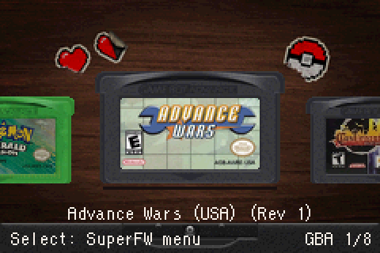
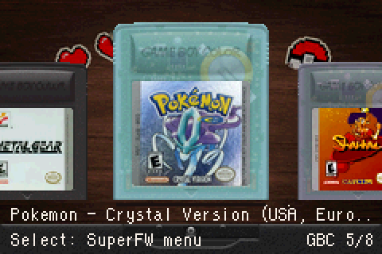
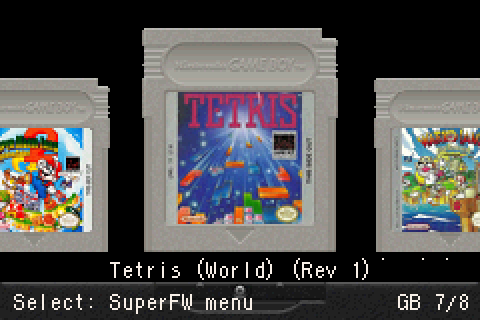
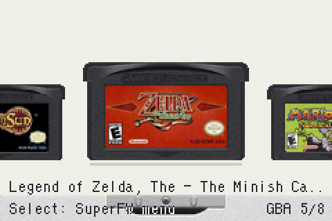

# slot. superchis

A [slot.](https://github.com/slot-cfw/slot)-style cartridge carousel for the **SuperChis Prime** GBA
flashcart. Your games sit on a shelf as carts; pick one, it slides into the slot, and
[SuperFW](https://github.com/davidgfnet/superfw) launches it.

<!-- TODO(terry): a sentence or two in your own words on why this exists. -->

**[⬇ Download the latest release](https://github.com/tychay/slot-superchis/releases/latest)**: grab
`slot-superchis-v….gba` from the list of files, then follow [Install](#install).

---

## What does it look like?

<p align="center">


</p>
<p align="center">


</p>

Screenshots come from the emulator preview build, with label art made in
[slot. Cart Studio](https://studio.slot-cfw.fyi).

**Video:** SuperChis Prime on a modded GBA (AGB-001).

[](https://youtu.be/s8WVENtDxms)

<!-- TODO(terry): animated GIFs later. -->

---

## Features

- **GBA, GB and GBC shelves**, read from `Games/GBA`, `Games/GB` and `Games/GBC` on the SD card.
- slot.'s **spring motion**, **insert animation** and **insert sound**.
- **Label art and cart colours** from [slot. Cart Studio](https://studio.slot-cfw.fyi). See
  [Label art](#label-art).
- **Wood, Dark and Light themes.**
- **Everything SuperFW does still works.** GBA games go through SuperFW's own load screen (saves,
  patches, in-game menu), GB/GBC games start in SuperFW's bundled emulator, and **Select** opens
  the stock SuperFW menu.
- **Remembers where you were**: shelf, cart and theme survive a power cycle.

## Requirements

- A **SuperChis Prime** with stock [SuperFW](https://github.com/davidgfnet/superfw) already
  flashed. This is the only cart it is built for. If you have an **EZ-Flash Omega**, check out
  [slot. advance](https://github.com/FrankieT19/slot-advance) instead.
- A GBA, GBA SP, Game Boy Micro or DS. Tested on an original GBA.
- Your games, **unzipped**.

## Install

Runs from the SD card. Nothing is flashed.

1. Download `slot-superchis-v0.1.0.gba` from the
   [latest release](https://github.com/tychay/slot-superchis/releases/latest) and copy it anywhere
   on the SD card.
2. Put your games in `Games/GBA` (`.gba`), `Games/GB` (`.gb`) and `Games/GBC` (`.gbc`) at the card
   root.
3. Boot stock SuperFW and launch `slot-superchis-v0.1.0.gba` from its file browser, like any
   other game.
4. Optional: add [label art](#label-art).

**Getting back after a game.** Quitting a game resets the cart into stock SuperFW, not the
carousel. Leave stock SuperFW's **UI → Recent ROMs** on (the default): it opens on its Recent tab
with `slot-superchis-v0.1.0.gba` at the top, so it's power on → **A**. Games you start from the
carousel are kept out of that list on purpose.

Saves stay in SuperFW's usual `SAVEGAME/` folder. The carousel keeps its own state in
`SYSTEM/SLOT/SETTINGS.TXT`.

**Uninstall:** delete the `.gba` file, and `SYSTEM/SLOT/` if you like. Nothing else changes.

## Controls

| Where | Button | Does |
|---|---|---|
| Carousel | Left / Right | Previous / next cart (hold to scroll) |
| Carousel | L / R | Previous / next shelf |
| Carousel | A | Insert the cart and start the game |
| Carousel | Hold B, press Start | Next theme |
| Carousel | Select | Stock SuperFW menu |
| GBA load screen | B | Back to the carousel |
| Stock menu, Settings / UI / Tools / Info tab | Select | Back to the carousel |

On the stock Recent and Browse tabs, Select keeps its SuperFW meaning, so move to one of the
tabs above with L/R first.

## Label art

The carousel shows the cart images that [slot. Cart Studio](https://studio.slot-cfw.fyi) makes.
Carts without art show a plain cart with the game's name.

This carousel reads the same art as [slot. advance](https://github.com/FrankieT19/slot-advance)
(`SYSTEM/SLOT/`). Cart Studio writes that format when it sees an EZ-Flash kernel file
(`ezkernel.bin`) at the card root. It only checks the name, so an empty file is enough:

1. Create an **empty file named `ezkernel.bin`** at the root of the SD card, next to `Games/`.
2. Open [studio.slot-cfw.fyi](https://studio.slot-cfw.fyi):
   - **Chrome or Edge:** choose the card, allow file editing, make your labels, then **Write to
     card**. Done.
   - **Safari or Firefox:** these can't write to a folder, so Cart Studio offers a download
     instead. Extract `labels.zip` and copy its `SYSTEM` folder to the card root. (Not yet
     tested.)
3. Boot the carousel. Art streams in as you scroll.

Cart Studio also writes a `Labels/` folder of plain pictures; the carousel ignores it. Remove
`ezkernel.bin` before putting the card in an EZ-Flash.

**On a Mac**, writing to the card leaves hidden `._` files that stock SuperFW's file browser lists.
Run `dot_clean -m /Volumes/<card>` before ejecting to remove them.

<details>
<summary>Converting a <code>labels.zip</code> that has no <code>SYSTEM</code> folder</summary>

Without `ezkernel.bin`, Cart Studio's download holds only plain label pictures. Convert them with
slot. advance's converter:

- **macOS / Linux** (needs Docker):

  ```sh
  git clone --recursive https://github.com/tychay/slot-superchis.git
  cd slot-superchis
  tools/convert_labels.sh ~/Downloads/labels.zip /Volumes/SUPERCHIS   # the card root
  ```

- **Windows:** run the Label Converter from
  [slot. advance's release](https://github.com/FrankieT19/slot-advance/releases) on the card.

</details>

For the flat cart look, set `Skeuomorphic=0` in `SYSTEM/SLOT/SETTINGS.TXT`.

## Caveats

- **SuperChis Prime only.** Other SuperCard boards are not built or tested.
- **Up to 2,048 games per shelf.** Beyond that the first 2,048 are shown and the footer says so.
- **Stock SuperFW's file browser** lists up to 12,288 files per folder in this build (16,384 in
  stock), because the carousel needs some of the cart's memory.
- **Flat folders only:** subfolders of `Games/GBA` and the others are not searched. Games whose
  full path is longer than 255 characters are skipped.
- **Quitting a game lands in stock SuperFW**, not the carousel (see [Install](#install)).
- **GBA games show SuperFW's load screen** after the insert animation; GB/GBC start straight away.
- Label art can appear a moment late when scrolling fast, mostly on GB/GBC.
- English only. Accented letters in game names show as `?`.

Planned and possible work is in [TODO.md](TODO.md).

## Flashing (untested)

The author has not flashed this build and does not own a DS to recover a cart, so this is
**untested**. Running from the SD card is the supported way. If you have the means to recover a
cart and want to try, reports are very welcome.

You need a recovery plan **before** you start: a DS or DS Lite, a Slot-1 flashcart and
[superfw-nds-flasher-tool](https://github.com/davidgfnet/superfw-nds-flasher-tool). Use that tool
to **back up your current flash first**. If the cart no longer boots, it is also how you restore
that backup.

Flashing works the same way as updating stock SuperFW:

1. Copy the release `.gba` to the card and rename the copy to end in `.fw`, e.g.
   `slot-superchis-v0.1.0.fw`.
2. Launch the carousel, press **Select**, and go to the **Info** tab.
3. Hold **Down + B + Start** to enable flashing.
4. Go to the **Browse** tab, pick the `.fw` file and confirm. Don't power off while it writes.
5. Reboot the GBA.

To go back to stock, flash the stock SuperFW `.fw` from its
[releases](https://github.com/davidgfnet/superfw/releases) the same way.

## Reporting problems

- **White screen after the "slot." splash:** run `slot-superchis-v0.1.0-diag.gba` from the release.
  It shows rows of coloured squares for each startup step and memory test. A photo of the screen
  tells us where it stopped.
- **Plain carts and no wood background:** the art pack failed to unpack.

[Open an issue](https://github.com/tychay/slot-superchis/issues) with your cart, console and SD
card size. [docs/TESTING.md](docs/TESTING.md) has the full hardware checklist.

## Building

Needs Docker running. The build runs in a container that mirrors upstream SuperFW's CI.

```sh
git clone --recursive https://github.com/tychay/slot-superchis.git
cd slot-superchis
./build.sh          # → superfw.gba
./build.sh clean
```

The build is reproducible: building a release tag gives the same bytes as the release file.
Emulator preview, screenshot harness and unit tests: [docs/DEVELOPMENT.md](docs/DEVELOPMENT.md).

## Architecture

The carousel is a separate program (`src/slot/`) that SuperFW copies to the cart's SDRAM at boot
and runs from there. SuperFW's own files change only in a few places, each marked `// slot:`.

- [adr/](adr/): architecture decisions. Start with
  [0004](adr/0004-carousel-as-sdram-payload-with-host-abi.md) (payload design) and
  [0010](adr/0010-sdram-is-16-bit-write-only-payload-statics-in-iwram.md) (SuperCard SDRAM rules).
- [openspec/](openspec/): specs and the archived design, including the
  [original change](openspec/changes/archive/2026-11-15-add-slot-carousel/).
- [TODO.md](TODO.md): planned work.

## AI Disclosure

<!-- TODO(terry): draft from Claude; rewrite in your own voice. -->

This port was built with [Claude Code](https://claude.com/claude-code). Claude wrote the code and
the design docs ([adr/](adr/), [openspec/](openspec/)) from my direction, and every build was
tested on a real SuperChis by me. That testing is how the cart's memory quirks were found.

slot. itself was also put together with AI (see its
[AI Disclosure](https://github.com/slot-cfw/slot#ai-disclosure)), so this fits right in. The real
stars are SuperFW, which does all the hard work of running your games, and the slot. design and
art.

## Credits

- [SuperFW](https://github.com/davidgfnet/superfw) by David Guillen Fandos: the firmware this is a
  fork of.
- [slot.](https://github.com/slot-cfw/slot) by Brandon Kowalski and contributors: the carousel
  design, motion, sounds and [Cart Studio](https://github.com/slot-cfw/cart-studio-web).
- Cartridge artwork by [Markus](https://github.com/MarkusMaribu).
- [slot. advance](https://github.com/FrankieT19/slot-advance) and DS Style by
  [FrankieT19](https://github.com/FrankieT19): the GBA port this carousel is adapted from.

Full notices, including fonts, are in [NOTICE.md](NOTICE.md). The original SuperFW README is in
[docs/SUPERFW-README.md](docs/SUPERFW-README.md).

## License

GPL-3.0-or-later. See [LICENSE](LICENSE).
